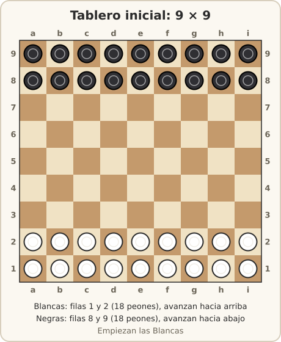
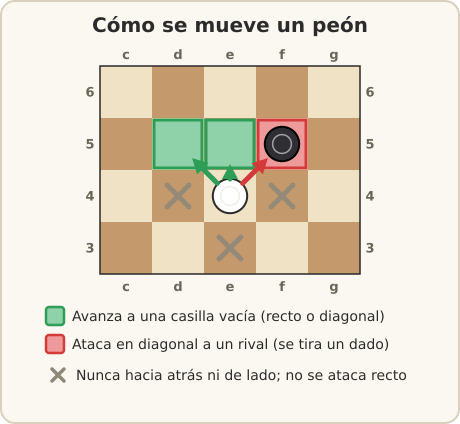
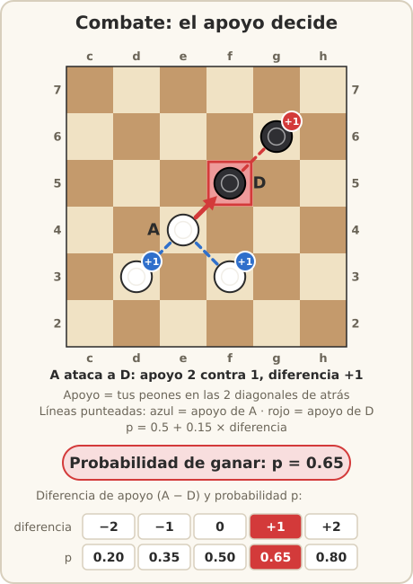
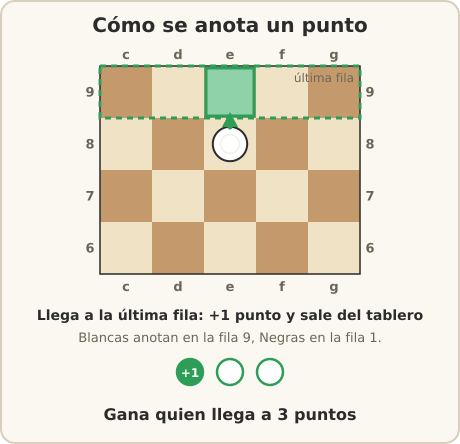

# Reglas

Reglas completas de **Breakthrough de combate**, del motor que usa tu bot y de cómo se ejecuta tu
bot en la liga. Cada ejemplo de esta página también es un test del código
(`sistema/tests/test_docs.py`): si el motor y esta página dijeran cosas distintas, el test fallaría.

- [El tablero](#el-tablero)
- [Movimiento](#movimiento)
- [Combate](#combate)
- [Puntos y fin de la partida](#puntos-y-fin-de-la-partida)
- [Los dados](#los-dados)
- [El motor](#el-motor)
- [Reglas de ejecución](#reglas-de-ejecución)

## El tablero



- 9 columnas (`a` a `i`) por 9 filas (`1` a `9`). Una casilla se escribe columna + fila: `e4`.
- Blancas: 18 peones en las filas 1 y 2. Negras: 18 peones en las filas 8 y 9.
- «Adelante» es hacia filas más altas para Blancas y hacia filas más bajas para Negras.
- **Empiezan Blancas.** Se alterna una jugada por turno. No se puede pasar.

## Movimiento

En tu turno mueves **un peón una casilla hacia adelante**:

- **Recto**, solo a una casilla vacía.
- **En diagonal** (adelante-izquierda o adelante-derecha), a una casilla vacía **o atacando** a un
  peón rival que esté ahí.
- Nunca hacia atrás ni de lado. No se ataca recto. No puedes mover a una casilla con un peón propio.

Una jugada se escribe origen-destino: `e4-e5`.



**Ejemplo 1: las tres jugadas de un peón.** Blancas en `e4`, Negras en `f5`, turno de Blancas.
Las jugadas legales son `e4-e5` y `e4-d5` (casillas vacías) y `e4-f5`, que es un ataque.

**Ejemplo 2: un rival enfrente bloquea.** Blancas en `e4`, Negras en `e5`. El peón no puede ir
recto (`e5` está ocupada y no se ataca recto). Le quedan `e4-d5` y `e4-f5`. Si además hay un peón
blanco en `d5`, `e4` solo puede ir a `f5`.

## Combate

Todo ataque se decide con un dado.

**Apoyo** de un peón: cuántos peones **propios** tiene en sus **dos casillas diagonales de atrás**
(0, 1 o 2). «Atrás» depende del color: para un peón blanco en `e4` son `d3` y `f3`; para un peón
negro en `f5` son `e6` y `g6`. El peón que está recto detrás no cuenta.

- El apoyo del **atacante** se cuenta desde su **casilla de origen**, antes de moverse.
- El apoyo del **defensor**, desde su casilla.

**Probabilidad de que gane el atacante:**

```text
p = 0.5 + 0.15 × (apoyo del atacante − apoyo del defensor)
```

(acotada entre 0.2 y 0.9; con apoyos de 0 a 2 el resultado siempre cae entre 0.2 y 0.8).

| Apoyo atacante − apoyo defensor | −2 | −1 | 0 | +1 | +2 |
|---|---|---|---|---|---|
| p | 0.20 | 0.35 | 0.50 | 0.65 | 0.80 |

- **Gana el atacante** (con probabilidad `p`): el defensor sale del tablero y el atacante ocupa su
  casilla.
- **Pierde el atacante** (con probabilidad `1 − p`): **el atacante** sale del tablero y el defensor
  se queda donde estaba.



**Ejemplo 3: combate con apoyo.** Blancas en `e4`, `d3`, `f3`; Negras en `f5`, `g6`; turno de
Blancas. La jugada `e4-f5` es un ataque.

```text
  a b c d e f g h i
6 . . . . . . N . . 6
5 . . . . . N . . . 5
4 . . . . B . . . . 4
3 . . . B . B . . . 3
```

- Apoyo del atacante (`e4`): `d3` y `f3` → 2.
- Apoyo del defensor (`f5`, negro): `e6` vacía, `g6` → 1.
- `p = 0.5 + 0.15 × (2 − 1) = 0.65`.
- Si gana (65 %): Blancas quedan en `d3`, `f3`, `f5`; Negras en `g6`.
- Si pierde (35 %): Blancas quedan en `d3`, `f3`; Negras siguen en `f5`, `g6`.

**Ejemplo 4: el apoyo se cuenta desde el origen.** Blancas en `e4` y `g4`, Negras en `f5`.
`g4` está en diagonal detrás de `f5` (el destino), no detrás de `e4` (el origen): no cuenta.
Apoyos 0 contra 0, así que `p = 0.50`.

**Ejemplo 5: atacan las Negras.** Negras en `d6` y `c7`; Blancas en `e5`, `d4`, `f4`; turno de
Negras. En `d6-e5`, el atacante (`d6`, negro) tiene apoyo 1 (`c7`; para Negras «atrás» es la fila
7). El defensor (`e5`, blanco) tiene apoyo 2 (`d4` y `f4`). `p = 0.5 + 0.15 × (1 − 2) = 0.35`.

## Puntos y fin de la partida

- Un peón que llega a la **última fila rival** (fila 9 para Blancas, fila 1 para Negras),
  caminando o ganando un ataque, **anota 1 punto y sale del tablero**.
- **Gana** quien:
  1. llega a **3 puntos**, o
  2. deja al rival **sin jugadas legales** en su turno (sin peones, o con todos bloqueados).
- **No hay empates ni límite de jugadas.** Ningún peón retrocede, así que toda partida termina, y
  siempre con un ganador.



**Ejemplo 6: anotar caminando.** Blancas en `e8`. Con `e8-e9` Blancas suman 1 punto y el peón
sale: ya no hay peón en `e9`.

**Ejemplo 7: anotar ganando un ataque.** Blancas en `e8` y `a2`; Negras en `f9` y `a9`. `e8-f9` es
un ataque con `p = 0.50` (nadie tiene apoyo). Si gana, Blancas suman 1 punto, `f9` queda vacía y el
peón de `e8` sale del tablero. Si pierde, sale el peón de `e8` y Negras siguen en `f9`.

**Ejemplo 8: el tercer punto gana.** Blancas tienen 2 puntos y un peón en `e8`. Con `e8-e9` llegan a
3 y ganan la partida en ese momento.

**Ejemplo 9: sin jugadas.** Si a Blancas les toca y no tienen peones, ganan las Negras. Un peón
también puede quedar **bloqueado**: Blancas en `a4` y `b5`, Negras en `a5` y `b6`. El peón de `a4`
no puede ir recto (`a5` ocupada) ni a su única diagonal (`b5` es propia). Pero `b5` sí puede
moverse (`b5-a6`, `b5-c6`), así que Blancas siguen jugando. Pierdes solo si **ninguno** de tus
peones puede moverse.

## Los dados

Los dados son justos y se pueden repetir.

- El árbitro tiene **dos generadores de números al azar, uno por color**. El ataque número *k* de
  un color usa el número *k* de su generador: un número `u` entre 0 y 1. El ataque gana si `u < p`.
- Contra cada rival juegas **4 partidas: 2 juegos de dados × 2 colores**. Con cada juego de dados
  llevas Blancas una vez y Negras otra. Así los dos reciben la misma «suerte de ataque» con cada
  color, y quien ataca con mejor apoyo gana más.
- Tu bot **nunca** conoce los dados. Conoce `p` antes de atacar y el resultado después (en el
  estado que recibe en su siguiente turno). Intentar adivinarlos o manipularlos es trampa.

## El motor

Tu bot importa el motor con `from motor import ...`. Es el mismo que usa el árbitro. Los estados no
cambian nunca: cada jugada crea un estado nuevo.

| Qué | Para qué |
|---|---|
| `estado.jugadas()` | Lista de jugadas legales del jugador en turno. Vacía si la partida terminó |
| `estado.siguiente(j)` | Resultados posibles de `j`: `[(1.0, nuevo)]` sin ataque; `[(p, si_gana), (1 − p, si_pierde)]` con ataque |
| `estado.aplicar(j)` | Estado después de `j`. En un ataque di el resultado: `aplicar(j, gana_ataque=True)` |
| `estado.prob_ataque(j)` | `p` si `j` es ataque; `1.0` si no |
| `estado.es_ataque(j)` | `True` si `j` ataca a un peón rival |
| `estado.turno` | `"blancas"` o `"negras"` |
| `estado.puntos` | Por ejemplo `{"blancas": 1, "negras": 0}` |
| `estado.piezas(color)` | Casillas de los peones de ese color, por ejemplo `["a1", "b1", ...]` |
| `estado.terminado()`, `estado.ganador()` | Si ya hay ganador, y cuál (`None` si sigue) |
| `estado.clave` | Número de 64 bits que identifica el estado: llave para tu tabla de transposición |
| `estado.dibujar()` | El tablero en texto (también con `print(estado)`) |
| `Estado.inicial()`, `Estado.desde_dict(d)` | Crear estados para tus pruebas |
| `Jugada.desde_texto("e2-e3")`, `str(j)` | Pasar de texto a jugada y de vuelta |
| `simular_al_azar(estado, n, semilla, para)` | Juega `n` partidas al azar desde `estado` y regresa qué fracción gana `para` (rápido: usa numba por dentro) |
| `prob_combate(apoyo_atacante, apoyo_defensor)` | La fórmula de `p` |
| `reportar(**datos)` | Opcional: lo que pensó tu bot en este turno, para el visor y `-v`. Ejemplo: `reportar(prof=4, nodos=12000, eval=0.62)` |

Ejemplo para probar en Python:

```python
from motor import Estado, Jugada

e = Estado.desde_dict({"blancas": ["e4", "d3", "f3"], "negras": ["f5", "g6"], "turno": "blancas"})
j = Jugada.desde_texto("e4-f5")
print(e.prob_ataque(j))                            # 0.65
for p, s in e.siguiente(j):                        # (0.65, gana) y (0.35, pierde)
    print(p, s.piezas("blancas"))
```

`jugar` puede regresar una `Jugada` o su texto (`"e4-f5"`). El árbitro la convierte con `str()` y
revisa que sea legal. Cualquier otra cosa (una tupla, `None`) es una jugada ilegal.

## Reglas de ejecución

**Principio: misma entrada, misma salida; en medio, lo tuyo.** Tu bot recibe un estado y regresa una
jugada. Lo que pase en medio es tuyo: algoritmo, heurística, modelo, optimización. Tres
excepciones: nada de redes neuronales, nada de trampas y código legible.

### Cómo corre tu bot

- **Información perfecta en cada turno.** `config.color` es tu color toda la partida, y cuando se
  llama `jugar` siempre te toca a ti (`estado.turno == config.color`). El `estado` trae todo:
  tablero, puntos y turno. Puedes decidir cada turno sin recordar nada.
- **Durante la partida** puedes guardar en memoria lo que quieras (árboles, tablas, caché) en
  variables globales de tu módulo.
- **Tu carpeta es de solo lectura.** Puedes leer tus archivos de `data/`; no puedes escribir ni
  crear archivos.
- **Cada partida es un proceso nuevo.** Al terminar se borra todo: nada pasa a la siguiente partida.
- **Sin red.** Mientras juega el rival tu bot está **congelado**: no puede pensar en el turno ajeno.
- Lo que quieras saber de antemano lo **precomputas en tu máquina antes de entregar** y lo guardas
  en `data/`.

### Límites

Los mismos en tu máquina (con `./torneo`) y en la liga:

<!-- limites:inicio -->
| Recurso | Límite |
|---|---|
| Reloj | 30 s por partida, estilo ajedrez: solo corre en tu turno |
| `preparar` (incluye importar `strategy.py`) | 10 s, fuera del reloj |
| CPU | 1 núcleo |
| Memoria | 1024 MB |
| Tu carpeta | 100 MB en total y 50 MB por archivo |
| Lo que imprimes (`print`) | se guarda hasta 64 KB por partida |
| Librerías de `requirements.txt` | 300 MB instalados |
<!-- limites:fin -->

- **El reloj** es tuyo para toda la partida. Corre desde que el árbitro te manda el estado hasta que
  recibe tu jugada, así que incluye el pequeño tiempo de comunicación. `tiempo_restante` te dice
  cuánto te queda (nunca es negativo). No pienses hasta el último milisegundo: deja reserva.
- **`preparar`** tiene 10 s aparte del reloj. Cuenta también el tiempo de importar tu
  `strategy.py`: lo que hagas a nivel de módulo (cargar archivos, compilar con numba) cuenta ahí.
- Lo que imprimas con `print` no rompe nada: se guarda aparte y lo ves con `-v` y en el visor.

### Pierdes esa partida (y solo esa) si…

- se acaba tu reloj;
- regresas una jugada ilegal o mal formada;
- tu código lanza una excepción;
- tu proceso muere (por ejemplo, por pasarte de memoria);
- `preparar` (con la importación de `strategy.py`) tarda más de 10 s.

Sigues en la liga y juegas tus demás partidas. Si la falla es **nuestra** (la máquina, Docker, el
árbitro), la pareja completa se vuelve a jugar con los mismos dados y no cuenta como derrota.

### Qué se vale y qué no

**Se vale:**

- Cualquier búsqueda (lo visto en la unidad y sus variantes) y cualquier heurística o función de
  evaluación.
- Modelos que no sean redes neuronales: pesos lineales o logísticos, tablas de patrones, árboles de
  decisión, etc., explicados en tu informe.
- Libros de aperturas, tablas de finales, cualquier precomputado en `data/` (cualquier formato,
  `pickle` incluido).
- numba, las librerías preinstaladas (numpy, scipy, numba) y las que declares en
  `requirements.txt` ([docs/avanzado.md](avanzado.md#librerías-requirementstxt)).
- Usar, modificar o reescribir el motor (copiándolo a tu carpeta con otro nombre:
  [docs/avanzado.md](avanzado.md#modificar-el-motor)).
- Hilos o procesos (se valen, pero tienes 1 núcleo: no ganas nada).
- Código genérico de internet, citado en tu informe.
- **Offline (en tu computadora, para generar `data/`): absolutamente todo**, cualquier librería y
  todos los núcleos que tengas.

**No se vale** (es trampa, ver la lista completa en
[docs/calificacion.md](calificacion.md#qué-es-trampa)): redes neuronales en la liga, código
ofuscado, código nativo propio, salir del aislamiento, adivinar o manipular los dados, copiar o
compartir código o datos con otros equipos antes de la entrega, y ponerse de acuerdo con otro
equipo. **Trampa o intento de trampa = 0 en el torneo para todo el equipo.**

**¿Por qué se limitan las librerías?** Queremos que mejores tu algoritmo, no que compitas por quién
encuentra la mejor herramienta. ¿Quieres otra librería? Pídela; si se aprueba, queda para todos.
